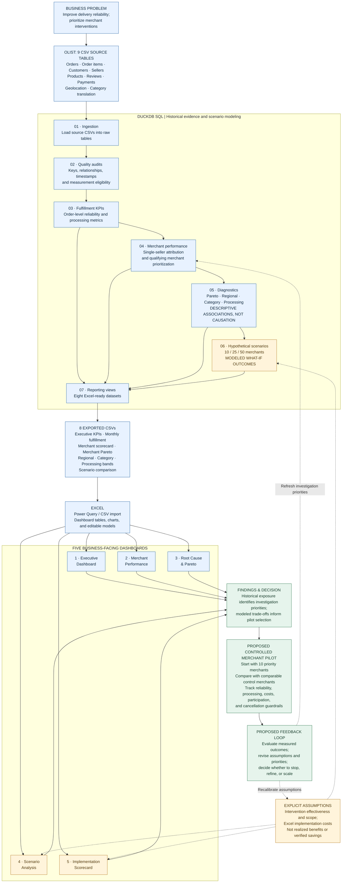
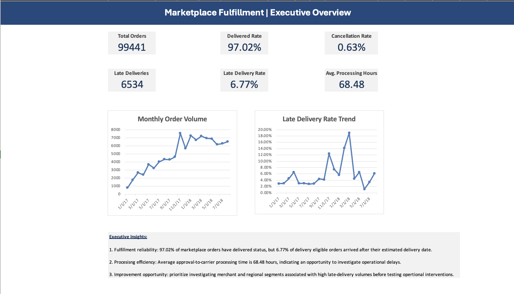
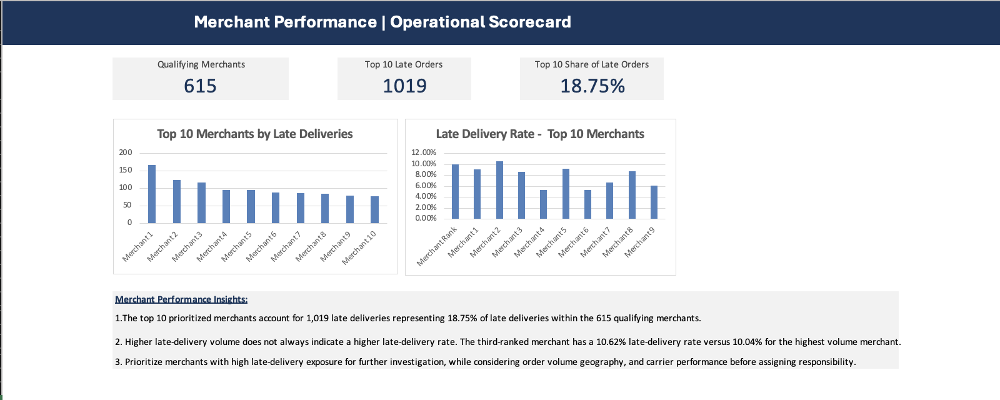
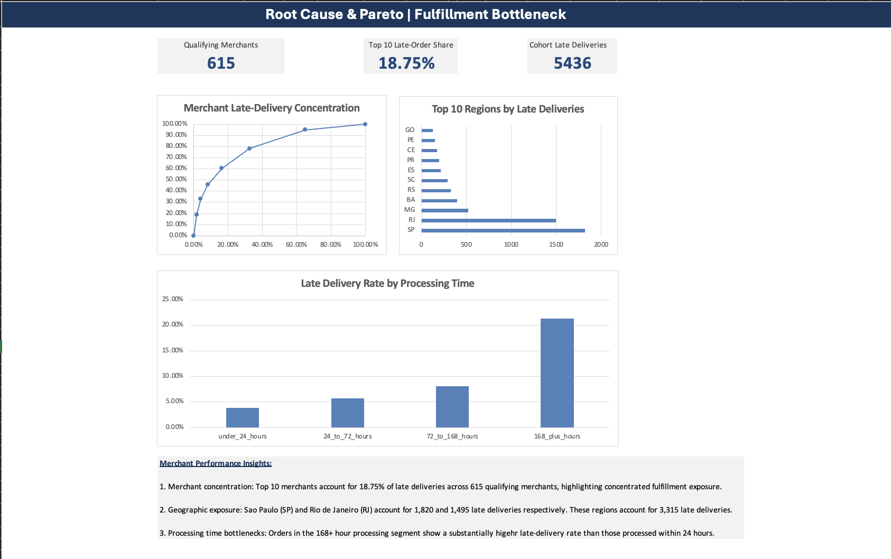
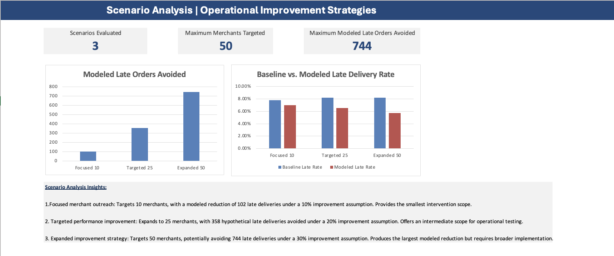
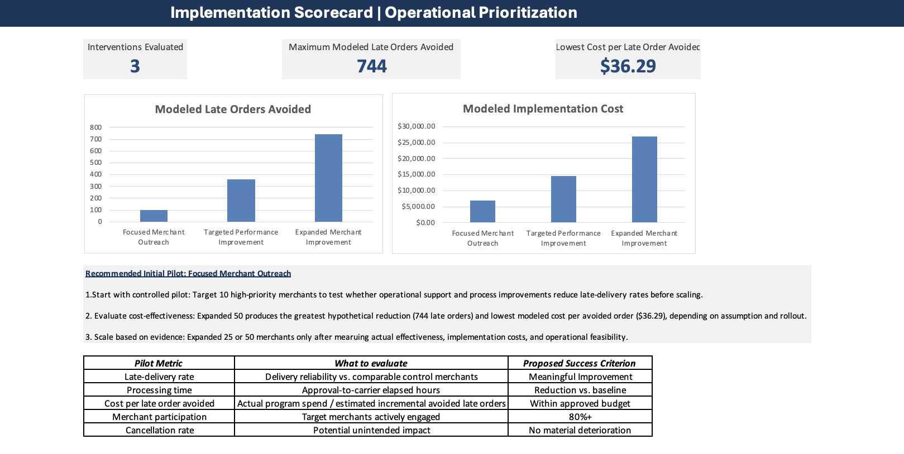

# Marketplace Fulfillment Intelligence

**DuckDB SQL · Excel · Marketplace Operations · Merchant Performance**

An end-to-end analysis of **99,441 historical Olist orders**, connecting fulfillment measurement, merchant prioritization, diagnostic analysis, and hypothetical intervention planning. The final deliverables include seven SQL scripts, eight reporting CSVs, and five Excel dashboards.

**Business question:** Where should a marketplace operations team investigate delivery delays, and which merchant interventions should it test before scaling?

[Executive summary](docs/executive_summary.md) · [Excel workbook](excel/Marketplace_Fulfillment_Intelligence.xlsx) · [SQL analysis](sql/) · [Reporting exports](outputs/tables/)

## Business Problem

A marketplace operations team needs to improve delivery reliability while deciding where to spend limited merchant-support resources. A marketplace-wide late-delivery rate alone does not show which merchants account for the most exposure, whether processing patterns warrant investigation, or which intervention is worth testing.

Using historical Olist data, I framed the analysis around four decisions:

1. **Measure the baseline:** How often are orders delivered late or canceled, and how long does processing take?
2. **Prioritize investigation:** Which merchants, regions, and product categories account for late-delivery exposure?
3. **Compare options:** How would different intervention scopes and effectiveness assumptions change modeled outcomes and costs?
4. **Plan validation:** What should a controlled pilot measure before a broader rollout?

## Solution & Recommendation

I built a DuckDB-to-Excel analytical workflow that turns nine transactional CSV tables into consistent fulfillment KPIs, merchant scorecards, diagnostic views, and business-facing dashboards. The solution connects historical performance measurement with editable scenario models so an operations team can investigate priorities and compare possible actions.

**My recommendation is to start with a controlled 10-merchant outreach pilot.** The top 10 prioritized merchants account for 1,019 late deliveries, or 18.75% of late deliveries in the qualifying merchant cohort. That concentration supports investigation and pilot selection; it does not establish merchant responsibility for those delays.

The pilot would test whether targeted merchant support improves delivery reliability relative to comparable control merchants. Success measures would include late-delivery rates, processing times, participation, actual intervention costs, and cancellation guardrails. Expansion to 25 or 50 merchants would depend on measured results and operational feasibility, rather than the modeled benefits alone.

**Delivered:** a reporting and decision-support workflow. **Proposed next action:** a controlled pilot. No intervention outcomes or realized savings are claimed.

## System Architecture & Analytical Decision Flow

The workflow moves from a business question to validated historical reporting, then to explicit what-if assumptions and a proposed controlled pilot. Solid arrows show the analytical workflow; dashed arrows show assumptions and a **proposed future feedback loop**, not an implemented production integration.

**How to read the evidence:** Blue nodes represent historical data and descriptive reporting. Amber nodes contain hypothetical improvements or costs. Green nodes connect findings to a **recommended, not completed**, pilot and learning cycle. The dashboard title “Root Cause & Pareto” describes an investigation tool; the analysis does not establish causal responsibility for delays.

## Historical Findings

| Measure | Historical result |
|---|---:|
| Marketplace orders | 99,441 |
| Delivered orders | 96,478 |
| Cancellation rate | 0.63% |
| Delivery-eligible orders | 96,470 |
| Late deliveries | 6,534 |
| Late-delivery rate among eligible orders | 6.77% |
| Average approval-to-carrier processing time | 68.48 hours |
| Qualifying merchants | 615 |
| Top 10 merchants' share of qualifying-cohort late deliveries | 18.75% |

The top 10 prioritized merchants are associated with **1,019 late deliveries**. Their 18.75% share uses the qualifying merchant cohort as its denominator, not the entire marketplace. Merchant prioritization uses single-seller orders and requires at least 30 delivery-eligible orders per merchant. Processing-time averages use processing-eligible orders.

These patterns identify where to investigate. They do not prove that merchants caused delays or that an intervention will deliver a particular improvement.

## Excel Dashboard Showcase

### 1. Executive Dashboard

Marketplace volume, delivery reliability, processing performance, cancellations, and monthly trends.

### 2. Merchant Performance

Merchant late-delivery volumes and rates support prioritization while distinguishing exposure from failure frequency.

### 3. Root Cause & Pareto

Late-delivery concentration, regional exposure, and processing patterns guide investigation. These are **descriptive associations**, not causal estimates.

### 4. Scenario Analysis

Editable effectiveness assumptions compare hypothetical merchant interventions. Modeled avoided late orders are **not realized improvements**.

### 5. Implementation Scorecard

Assumed intervention costs, modeled cost-effectiveness, rollout scope, and proposed pilot success criteria support a test-before-scale decision.

## Hypothetical Scenarios & Pilot Recommendation

| Scenario | Merchants targeted | Assumed late-order reduction | Modeled late orders avoided | Assumed implementation cost | Cost per modeled late order avoided |
|---|---:|---:|---:|---:|---:|
| Focused Outreach | 10 | 10% | 102 | $7,000 | $68.63 |
| Targeted Improvement | 25 | 20% | 358 | $14,500 | $40.50 |
| Expanded Improvement | 50 | 30% | 744 | $27,000 | $36.29 |

SQL supplies historical baselines and modeled operational outcomes; the Excel implementation scorecard adds assumed costs. These are alternative scenarios and must **not be added together**. Costs and effectiveness are assumptions, not measured savings or validated intervention results.

**Recommended next step: a controlled pilot with 10 high-priority merchants.** Although the 50-merchant scenario has the lowest modeled cost per avoided late order, its assumptions remain unvalidated. Compare pilot merchants with comparable control merchants; measure late-delivery rates, processing times, actual costs, participation, and cancellation guardrails. Use the results to refine assumptions and decide whether expansion to 25 or 50 merchants is justified.

## Repository Guide

| Stage | File | Purpose |
|---|---|---|
| 01 | [Data ingestion](sql/01_data_ingestion.sql) | Load nine Olist source CSVs into DuckDB |
| 02 | [Data quality audit](sql/02_data_quality_audit.sql) | Inspect keys, relationships, and data quality |
| 03 | [Fulfillment KPIs](sql/03_fulfillment_kpis.sql) | Define order-level metrics and monthly trends |
| 04 | [Merchant performance](sql/04_merchant_performance.sql) | Attribute single-seller orders and prioritize merchants |
| 05 | [Diagnostics and Pareto](sql/05_root_cause_pareto.sql) | Examine concentration, regional, category, and processing patterns |
| 06 | [Scenario analysis](sql/06_scenario_analysis.sql) | Model hypothetical intervention outcomes |
| 07 | [Excel reporting views](sql/07_excel_reporting_views.sql) | Create reporting views and export eight CSVs |

### Eight Reporting Exports

- [Executive KPIs](outputs/tables/executive_kpis.csv)
- [Monthly fulfillment](outputs/tables/monthly_fulfillment.csv)
- [Merchant scorecard](outputs/tables/merchant_scorecard.csv)
- [Merchant Pareto](outputs/tables/merchant_pareto.csv)
- [Regional performance](outputs/tables/regional_performance.csv)
- [Category performance](outputs/tables/category_performance.csv)
- [Processing bands](outputs/tables/processing_bands.csv)
- [Scenario comparison](outputs/tables/scenario_comparison.csv)

Run SQL scripts 01–07 in numerical order against the same DuckDB database from the repository root, with the nine source files available in `data/raw/`. Script 07 writes to `outputs/tables/`. Import or refresh those CSVs in Excel using Power Query / CSV import, then review dashboard formulas and scenario assumptions. The diagram describes this analytical workflow; it does not imply an automated refresh pipeline.

## Challenges I Addressed

The main analytical challenges were defining reliable measurements and making recommendations that stayed within what the data could support.

| Challenge | How I addressed it | Why it mattered |
|---|---|---|
| Incomplete or inconsistent timestamps | The quality audit identified 8 delivered orders without delivery timestamps, 1,350 with carrier timestamps before approval, and 23 with delivery timestamps before carrier handoff. I applied metric-specific eligibility rules while preserving the raw records. | Each KPI uses an appropriate denominator, and invalid durations do not distort averages. |
| Different levels of detail across tables | The dataset contains 112,650 item records for 99,441 orders, including multi-item orders. I kept marketplace fulfillment KPIs at the order level. | Joining item records directly into order counts could inflate volume and misstate performance. |
| Ambiguous merchant attribution | There are 1,278 multi-seller orders. I used single-seller orders for primary merchant comparisons and required at least 30 delivery-eligible orders for the priority cohort. | This avoids assigning a shared order's delay to one seller without evidence and limits comparisons based on very small samples. |
| Preserving the full marketplace picture | I retained orders without item records in status analysis; the audit found 775 such orders, mostly unavailable or canceled. | Restricting every analysis to orders with items would omit relevant operational outcomes. |
| Separating exposure, causation, and modeled impact | I compared late-order volume with late-delivery rates, labeled diagnostic findings as associations, and separated scenario assumptions from historical results. | A high-priority merchant is an investigation candidate, and a modeled improvement is a hypothesis to test. |
| Keeping SQL outputs and Excel decisions consistent | I used eight reporting exports to connect SQL calculations to dashboards and checked workbook results and editable assumptions during the final audit. | The presentation and decision models need to remain traceable to the same historical baselines. |

The [data quality audit summary](docs/phase1_audit_summary.md) documents the timestamp, order-grain, and attribution constraints behind these choices.

## What I Would Improve Next Time

1. **Define the measurement contract earlier.** I would document each KPI's grain, eligibility rules, denominator, and intended decision before building dashboards, then maintain those definitions alongside the SQL.
2. **Automate validation and refresh checks.** I would add repeatable checks for key uniqueness, join cardinality, timestamp eligibility, and reconciliation between SQL exports and Excel totals, with a visible refresh date and exception log.
3. **Test uncertainty more systematically.** I would expand the scenario models with low, base, and high effectiveness and cost assumptions, and examine how sensitive merchant priorities are to cohort thresholds and analysis periods.
4. **Design the pilot evaluation before recommending scale.** I would specify control selection, baseline and follow-up periods, minimum detectable effects, success thresholds, and guardrails in advance. Random assignment would be preferable where operationally feasible.
5. **Add operational context where available.** Carrier events, merchant capacity, intervention participation, and actual support costs could help distinguish possible sources of delay and replace assumed inputs with measured ones.
6. **Make the handoff easier to reproduce.** I would package the SQL run order, data requirements, Excel import steps, and formula sensitivity checks into a concise refresh guide so another analyst could maintain the workflow.

These are proposed improvements for a future iteration, not capabilities already implemented in this version.

## Assumptions & Limitations

- The source is the public Brazilian e-commerce dataset by Olist, not proprietary DoorDash operational data.
- Merchant attribution primarily uses single-seller orders; the qualifying cohort is a subset of marketplace sellers.
- Delivered orders and delivery-eligible orders differ; KPI denominators depend on timestamp and eligibility checks.
- Historical associations do not establish causation or merchant responsibility.
- Processing time measures elapsed hours, not direct labor savings.
- Scenario effectiveness and implementation costs are hypothetical; a controlled evaluation is needed before claiming realized business impact.

See the [executive summary](docs/executive_summary.md) for the business interpretation and the linked SQL scripts for implemented calculations.
